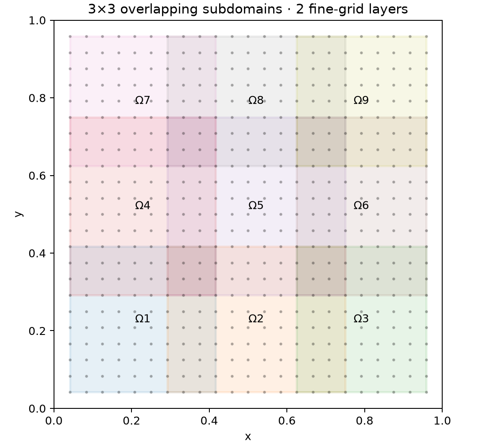
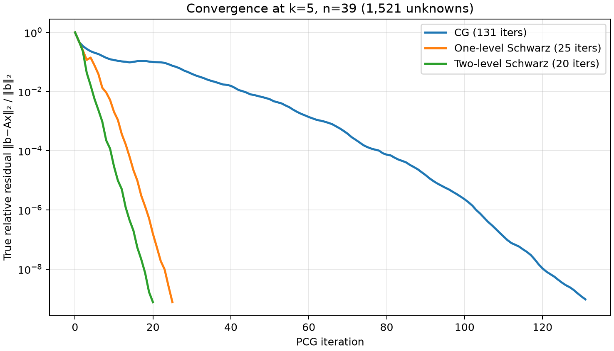
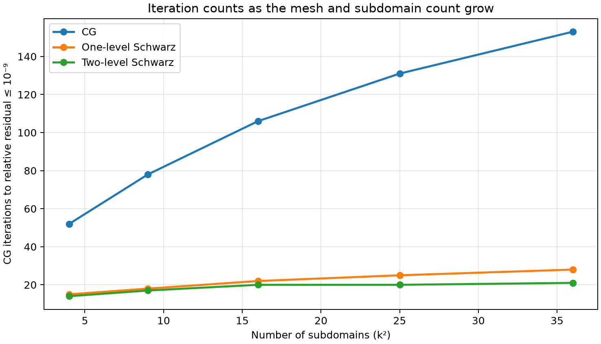
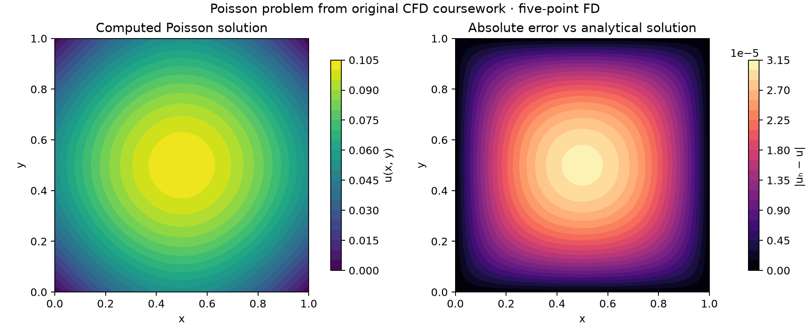

# Overlapping Schwarz Preconditioners for the 2D Poisson Equation

**Sparse Python implementation of one- and two-level additive Schwarz preconditioners, with conjugate gradient benchmarks, manufactured-solution tests, and reproducible figures.**

I revisited my Computational Fluid Dynamics coursework on domain decomposition and preconditioned iterative methods. I developed this new, verifiable Python implementation to compare unpreconditioned conjugate gradients (CG), overlapping additive Schwarz, and a two-level Schwarz method with a coarse grid correction. I preserved my **original, unmodified MATLAB drafts** under [`legacy/coursework/`](legacy/README.md).

> **Scope:** This is a numerical linear algebra project from my CFD coursework. It solves a *scalar Poisson equation*, **not** the Navier–Stokes equations. No MATLAB licence is needed.

## Why domain decomposition?

Large discretized PDE systems often benefit from preconditioners that solve smaller local problems. Overlapping additive Schwarz combines local corrections. A second-level coarse correction is intended to improve the treatment of error components not efficiently removed locally.



*Illustration from the implementation: nine overlapping subdomains, enlarged by two fine grid node layers.*

## Methods compared

For the Poisson problem $-\Delta u=f$ on $(0,1)^2$ with Dirichlet boundary data, I assemble a symmetric positive-definite **five point finite difference** system using sparse Kronecker products.

| Method | Action |
|---|---|
| **CG** | Unpreconditioned conjugate gradients |
| **One-level additive Schwarz** | $M_1^{-1}=\sum_i R_i^\mathsf{T}(R_i A R_i^\mathsf{T})^{-1}R_i$ |
| **Two-level additive Schwarz** | $M_2^{-1}=M_1^{-1}+P(P^\mathsf{T}AP)^{-1}P^\mathsf{T}$ |

The preconditioners use **sparse local factorizations**, never a dense global inverse. The coarse prolongation $P$ is piecewise bilinear on a regular grid. See [numerical formulation](docs/method.md) for precise conventions, including how the original coursework has been reinterpreted and corrected.

## Example: preconditioned CG convergence



On a grid with **1521 unknowns**, 25 overlapping subdomains and two layers of overlap, the observed iteration counts to a relative residual of $10^{-9}$ were:

| Solver | Iterations |
|---|---:|
| Unpreconditioned CG | **131** |
| One-level overlapping Schwarz + CG | **25** |
| Two-level overlapping Schwarz + CG | **20** |

The two level method requires fewer iterations in these tests, but **iteration counts are not runtime speedups**: the local and coarse factorizations influence setup and application cost. These serial experiments do not demonstrate parallel acceleration or general mesh independent convergence.



*Additional measured cases with k×k subdomains and n = 8k − 1 interior nodes per axis. Full data: [`results/iteration_counts.csv`](results/iteration_counts.csv).*

## Verification against my original coursework

The MATLAB files use the forcing term

$$
f(x,y)=2\big[x(1-x)+y(1-y)\big].
$$

One coursework file specifies the analytical solution

$$
u(x,y)=\tfrac16\big(x^4-2x^3+x+y^4-2y^3+y\big).
$$

I verified this **with its actual nonzero Dirichlet boundary values**. Treating it as zero on every boundary would be mathematically inconsistent. The new solver reproduces the original PDE data with a sparse interior node formulation. Separate sine and zero-boundary polynomial tests check discretization accuracy and exact consistency with the five point stencil.



*Computed Poisson solution from the coursework source and its error relative to the analytical polynomial at 39×39 interior nodes.*

This is a **reconstruction of the original mathematical problem**. See [coursework provenance](legacy/README.md) and [verification details](docs/verification.md).

## Reproduce locally

Requires Python **3.11 or newer** (tested locally with Python 3.13). From the repository root:

```bash
python3 -m venv .venv
source .venv/bin/activate
python -m pip install -e ".[dev]"

python -m pytest -q
python scripts/run_demo.py
python scripts/run_benchmarks.py
```

The demo saves `figures/poisson_solution.png`. The benchmark regenerates `figures/subdomain_overlap.png`, `figures/pcg_residuals.png`, `figures/scaling_iterations.png`, and `results/iteration_counts.csv` using deterministic inputs. A `Makefile` also provides `make test`, `make demo`, and `make benchmark`.

**GitHub Actions** runs the numerical tests and regenerates the figures on Ubuntu under Python 3.11 and 3.13. These checks exercise the new Python solver, not the historical MATLAB sources.

## Repository layout

```text
src/schwarz_dd/          Sparse Poisson model, Schwarz preconditioners, CG diagnostics
scripts/                 Reproducible PDE demo and iterative-solver benchmarks
tests/                   Numerical and structural regression tests
figures/                 Generated scientific plots displayed in this README
results/                 Machine-readable deterministic iteration counts
docs/                    Mathematical formulation, test protocol and limitations
legacy/coursework/       Original MATLAB coursework scripts (unaltered)
.github/workflows/       Licence-free continuous integration
```

## Limitations

The implementation uses a regular 2D grid, a scalar constant coefficient Poisson operator, sparse direct local solves and **serial** additive Schwarz. The benchmark measures **iterations**, not wall-clock speed or parallel scalability. The legacy MATLAB drafts are included for provenance and have not been validated.

I have not assigned an open-source licence to the repository. A suitable licence can be added if I choose to grant reuse permissions.
